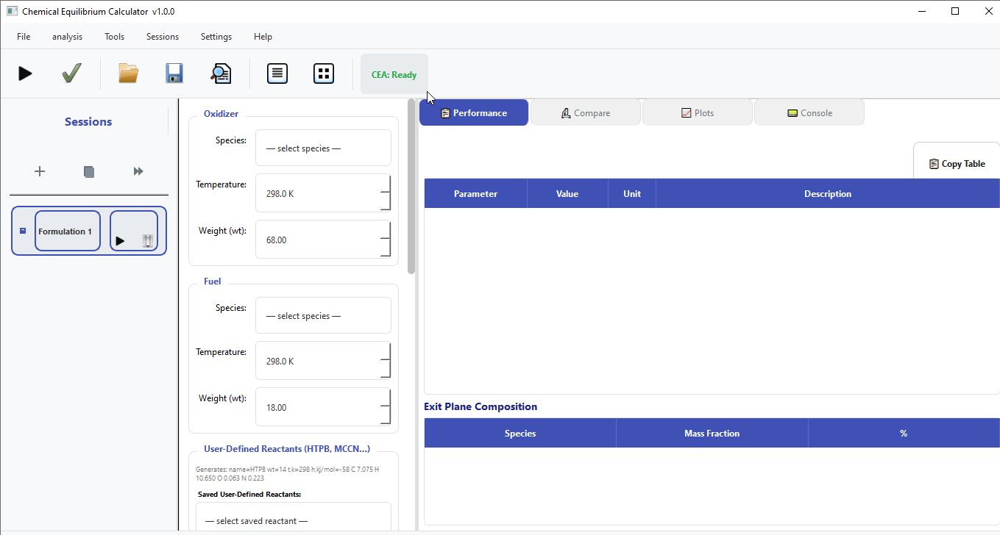
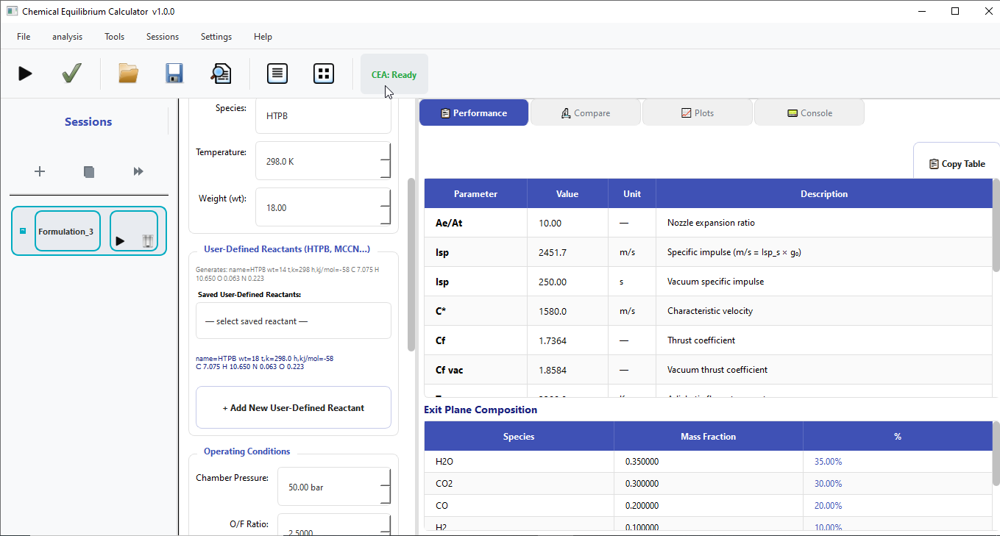
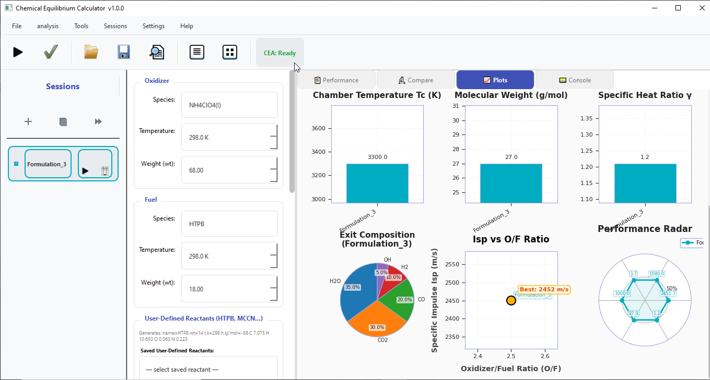
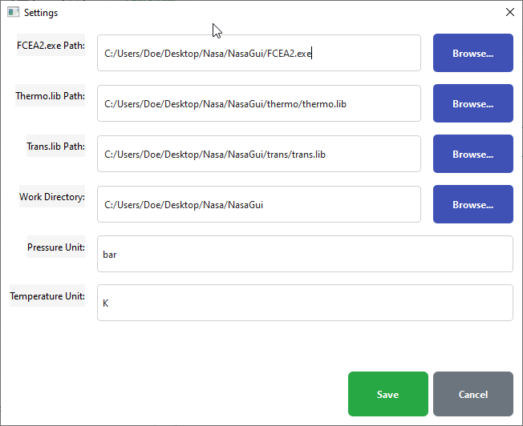

<!--
  Chemical Equilibrium Calculator — README
  Author: Oukil Khaled Ibn Elwalid (@khadev)
  License: GPL-3.0
-->

<div align="center">


# ⚗️ Chemical Equilibrium Calculator

### Professional Thermodynamic Analysis Suite for Propulsion & Combustion

**Precise equilibrium composition · NASA CEA2 integration · 25+ engineering tools**

<!-- ═══════════════════════════════════════════════════════════════════ -->
<!--  BADGES — Responsive, Modern, Grouped                             -->
<!-- ═══════════════════════════════════════════════════════════════════ -->

<p align="center">
  <a href="https://pypi.org/project/chem-eq-calculator/">
    
  </a>
  <a href="https://pypi.org/project/chem-eq-calculator/">
    
  </a>
  <a href="https://www.gnu.org/licenses/gpl-3.0">
    
  </a>
  <a href="#-installation">
    
  </a>
</p>

<p align="center">
  <a href="https://github.com/khadev/Chemical-Equilibrium-Calculator/stargazers">
    
  </a>
  <a href="https://github.com/khadev/Chemical-Equilibrium-Calculator/network/members">
    
  </a>
  <a href="https://github.com/khadev/Chemical-Equilibrium-Calculator/issues">
    
  </a>
  <a href="https://github.com/khadev/Chemical-Equilibrium-Calculator/commits/main">
    
  </a>
</p>

<!-- Gradient-style divider (renders reliably on GitHub) -->
<p align="center">
  
</p>

[**📥 Install**](#-installation) · [**🚀 Quick Start**](#-quick-start) · [**✨ Features**](#-features) · [**📸 Screenshots**](#-screenshots) · [**📚 Docs**](#-usage-guide) · [**🤝 Contribute**](#-contributing)

</div>

---

## 📖 Table of Contents

<details open>
<summary><b>Click to expand / collapse</b></summary>

- [Overview](#-overview)
- [Features](#-features)
- [Screenshots](#-screenshots)
- [Installation](#-installation)
- [Quick Start](#-quick-start)
- [Usage Guide](#-usage-guide)
- [NASA CEA2 Integration](#️-nasa-cea2-integration)
- [Configuration](#️-configuration)
- [Project Structure](#-project-structure)
- [Requirements](#-requirements)
- [Roadmap](#-roadmap)
- [Troubleshooting](#-troubleshooting)
- [Contributing](#-contributing)
- [Citation](#-citation)
- [License](#-license)
- [Acknowledgements](#-acknowledgements)
- [Author](#-author)

</details>

---

## 🔬 Overview

**Chemical Equilibrium Calculator** is a professional-grade desktop application for **thermodynamic equilibrium analysis** of chemical systems. Designed for researchers, engineers, and students in **propulsion, combustion, and thermodynamics**, it combines a modern Qt6 interface with a modular MVC architecture and industry-standard calculation engines.

At its core, the application solves complex **multi-species equilibrium compositions** via free-energy minimization, then derives the full set of thermodynamic and performance properties required for propulsion system design.

> 💡 **High-precision mode** leverages **NASA's CEA2** for rigorous equilibrium calculations, while a built-in **ideal-gas fallback engine** ensures the software remains functional even without external dependencies.

### Why Choose This Tool?

| | Feature | Benefit |
|---|---|---|
| ⚡ | **Fast & Accurate** | High-precision equilibrium solver with NASA CEA2 |
| 🧩 | **Modular Architecture** | Clean MVC design — easy to extend and integrate |
| 🎨 | **Modern UI** | Native Qt6 interface with dark/light themes |
| 🌍 | **Bilingual** | Full English & French localization |
| 📊 | **Rich Analytics** | 25+ built-in engineering tools |
| 🔁 | **Reproducible** | Export results to CSV, Excel, LaTeX, or Python scripts |
| 🆓 | **Open Source** | GPL-3.0 licensed — free for research & education |

---

## ✨ Features

### ⚗️ Core Calculation Engine

<details>
<summary><b>Equilibrium & Thermodynamics</b></summary>

- Multi-species chemical equilibrium via **Gibbs free-energy minimization**
- Temperature, pressure, enthalpy, entropy, and Gibbs energy computation
- Species mole and mass fractions
- Adiabatic flame temperature
- Heat of combustion and mixture molecular weight
- Support for condensed phases and multi-phase products

</details>

<details>
<summary><b>Nozzle & Propulsion Analysis</b></summary>

- **Isentropic flow** analysis (subsonic / supersonic)
- **Nozzle designer** — Rao, conical, and bell contours
- **Chamber sizer** — L*, contraction ratio, residence time
- **Thrust coefficient** (Cf) and **characteristic velocity** (C*)
- **Specific impulse** (Isp) — vacuum and sea level
- **Expansion ratio** optimization
- **Two-phase flow** corrections

</details>

<details>
<summary><b>Thermal & Cooling Analysis</b></summary>

- Regenerative cooling channel designer
- Convective & radiative heat transfer estimates
- Wall temperature prediction
- **Combustion instability** predictor (acoustic modes)
- Coolant property database

</details>

<details>
<summary><b>Mission & Performance Tools</b></summary>

- **Delta-V calculator** (Tsiolkovsky & multi-stage)
- Orbit insertion & transfer analysis
- **Staging optimizer**
- Payload fraction estimation
- Gravity-loss corrections

</details>

<details>
<summary><b>Advanced Analysis & Scripting</b></summary>

- Parametric sweeps (Pc, O/F, Ae/At, etc.)
- **Sensitivity analysis** and **Design of Experiments (DOE)**
- Composition tracking across conditions
- **LaTeX report generator**
- **Python script export** (reproducible workflows)
- Batch processing with CSV output

</details>

### 🖥️ User Interface

| Feature | Description |
|---|---|
| **🔍 Searchable Species Database** | 129 oxidizers + 397 fuels with fuzzy auto-completion |
| **✓ Real-time Validation** | Pre-flight checks catch errors before calculation |
| **🪟 Session Management** | Multiple concurrent calculation sessions (tabs) |
| **🎨 Themeable Interface** | Dark / light modes with custom accent colors |
| **🌐 Multi-language** | English 🇬🇧 and French 🇫🇷 interfaces |
| **📁 Rich Export** | CSV, Excel, LaTeX, PNG plots, and Python scripts |
| **⌨️ Keyboard-First** | Full shortcut coverage for power users |
| **🖱️ Drag & Drop** | Import `.inp` files directly into the workspace |

---

## 📸 Screenshots

<div align="center">

### 🖥️ Main Application Interface

*Formulation panel, session management, and live results display*



<br/><br/>

### ➕ Add Reactant Dialog


&nbsp;&nbsp;


<br/><br/>

### 📊 Performance Analysis



<br/><br/>

### 📈 Plots & Visualization



<br/><br/>

### ⚙️ Settings Dialog



</div>

> 📁 All screenshots are available in the [`Screenshots/`](Screenshots/) directory.

---

## 🚀 Installation

### Prerequisites

- **Python ≥ 3.9**
- **pip ≥ 21.0**
- OS: Windows 10/11, Linux (Ubuntu 20.04+), or macOS 11+

### Option 1 — PyPI (Recommended)

```bash
pip install chem-eq-calculator
```

### Option 2 — From Source

```bash
# 1. Clone the repository
git clone https://github.com/khadev/Chemical-Equilibrium-Calculator.git
cd Chemical-Equilibrium-Calculator

# 2. (Recommended) Create a virtual environment
python -m venv .venv
source .venv/bin/activate          # Linux / macOS
# .venv\Scripts\activate           # Windows

# 3. Install dependencies
pip install -r requirements.txt

# 4. Launch
python main.py
```

### Option 3 — Development Install

```bash
git clone https://github.com/khadev/Chemical-Equilibrium-Calculator.git
cd Chemical-Equilibrium-Calculator
pip install -e ".[dev]"
```

---

## 🎯 Quick Start

### Launch the Application

```bash
chem-eq-calculator
```

### Five-Step Workflow

```text
┌─────────────────────────────────────────────────────────────┐
│  1. Select Oxidizer  →  NH₄ClO₄                            │
│  2. Select Fuel      →  HTPB                                │
│  3. Set Conditions   →  Pc, O/F, Ae/At                      │
│  4. Calculate        →  Ctrl+R  (or click "Calculate")      │
│  5. Analyze          →  Review Isp, C*, Tc, plots           │
└─────────────────────────────────────────────────────────────┘
```

### Example Formulation

| Parameter | Value |
|---|---|
| **Oxidizer** | NH₄ClO₄(I) |
| **Oxidizer Temperature** | 298.0 K |
| **Oxidizer Mass Fraction** | 72.0 % |
| **Fuel** | HTPB |
| **Fuel Temperature** | 298.0 K |
| **Fuel Mass Fraction** | 18.0 % |
| **Chamber Pressure** | 50.0 bar |
| **O/F Ratio** | 2.5 |
| **Area Ratio (Ae/At)** | 10.0 |

### Expected Output

| Metric | Value |
|---|---|
| **Specific Impulse (Isp)** | ≈ 250 s (2450 m/s) |
| **Characteristic Velocity (C*)** | ≈ 1580 m/s |
| **Thrust Coefficient (Cf)** | 1.55 – 1.65 |
| **Chamber Temperature (Tc)** | ≈ 3300 K |

> ℹ️ Values are indicative; exact results depend on the thermodynamic database version and CEA2 configuration.

---

## 📚 Usage Guide

### Session Management

Each calculation runs inside its own **session tab**, allowing side-by-side comparison of multiple formulations. Use `Ctrl+T` to create a new session and `Ctrl+W` to close it.

### Exporting Results

| Format | Shortcut | Use Case |
|---|---|---|
| **CSV** | `Ctrl+E` | Spreadsheet analysis |
| **Excel** | Menu → Export | Formatted reports |
| **LaTeX** | Toolbar | Publication-ready documents |
| **Python Script** | Menu → Export | Reproducible workflows |
| **Plots (PNG)** | Right-click plot | Presentations & papers |

### Keyboard Shortcuts

| Action | Shortcut |
|---|---|
| Calculate | `Ctrl+R` |
| Validate formulation | `Ctrl+Shift+V` |
| New session | `Ctrl+T` |
| Close session | `Ctrl+W` |
| Load `.inp` file | `Ctrl+O` |
| Save `.inp` file | `Ctrl+S` |
| Export CSV | `Ctrl+E` |
| Open settings | `Ctrl+,` |
| Toggle theme | `Ctrl+Shift+T` |
| Open help | `F1` |

---

## 🛰️ NASA CEA2 Integration

For mission-critical precision, the application integrates with **NASA's Chemical Equilibrium with Applications (CEA2)**.

> *CEA computes the equilibrium composition of mixtures via free-energy minimization and uses the resulting product concentrations to determine thermodynamic and transport properties.*

- **Source Code:** [github.com/nasa/cea](https://github.com/nasa/cea)
- **Documentation:** [nasa.github.io/cea](https://nasa.github.io/cea)

### Setup

```bash
pip install cea
```

Then, in the app:

1. Open **Settings** (`Ctrl+,`)
2. Set the following paths:
   - `FCEA2.exe` (Windows) or `cea` (Unix) executable
   - `thermo.lib` — thermodynamic database
   - `trans.lib` — transport properties database
3. Click **Save** and re-run a calculation to verify the CEA2 badge appears in the results panel.

> 💡 **Fallback behavior:** if CEA2 is not configured, the software transparently uses its built-in ideal-gas equilibrium engine — results will be close but not NASA-certified.

---

## ⚙️ Configuration

### Unit Preferences

| Quantity | Supported Units |
|---|---|
| **Pressure** | bar, psi, MPa, atm |
| **Temperature** | K, °C, °F |
| **Mass** | kg, g, lb |
| **Length** | m, cm, mm, in |

### Localization

| Language | Setting |
|---|---|
| English | `Settings → Language → English` |
| Français | `Settings → Language → Français` |

### Settings File

User settings persist in:

| OS | Path |
|---|---|
| Windows | `%APPDATA%\chem-eq-calculator\config.json` |
| Linux | `~/.config/chem-eq-calculator/config.json` |
| macOS | `~/Library/Application Support/chem-eq-calculator/config.json` |

---

## 📁 Project Structure

```text
Chemical-Equilibrium-Calculator/
├── chem_eq_calculator/              # Main Python package
│   ├── __init__.py
│   ├── main.py                      # Application entry point
│   ├── engine/                      # Calculation engines
│   │   ├── equilibrium.py           # Equilibrium solver
│   │   ├── thermodynamics.py        # Property calculations
│   │   ├── nozzle.py                # Nozzle & performance
│   │   └── cea_wrapper.py           # NASA CEA2 bridge
│   ├── models/                      # Data layer
│   │   ├── species.py
│   │   ├── mixture.py
│   │   └── session.py
│   ├── ui/                          # User interface (Qt6)
│   │   ├── widgets/
│   │   ├── dialogs/
│   │   └── themes/
│   ├── config/                      # App configuration
│   └── database/                    # Species & thermo databases
│       ├── databasecea.txt
│       ├── thermo.lib
│       └── trans.lib
├── Screenshots/                     # Documentation images
├── tests/                           # Unit & integration tests
├── docs/                            # Extended documentation
├── setup.py                         # Packaging configuration
├── pyproject.toml                   # Modern build config
├── requirements.txt                 # Runtime dependencies
├── MANIFEST.in                      # Package data inclusions
├── LICENSE                          # GPL-3.0
└── README.md                        # This file
```

---

## 📦 Requirements

### Runtime

```txt
PySide6>=6.6.0      # Qt6 bindings
matplotlib>=3.7.0   # Plotting
numpy>=1.24.0       # Numerical operations
pandas>=2.0.0       # Data export & analysis
qtawesome>=1.3.0    # Iconography
```

### Optional

```txt
cea                 # NASA CEA2 Python wrapper
openpyxl            # Excel export
pytest              # Test suite
```

---

## 🗺️ Roadmap

- [x] v1.1.2 — Current stable release
- [ ] **v1.2.0** — Equilibrium solver performance improvements
- [ ] **v1.3.0** — REST API for headless calculations
- [ ] **v1.4.0** — Plugin system for custom engines
- [ ] **v2.0.0** — Web-based UI (WASM build)
- [ ] **Future** — Real-time thermochemistry database updates

> 💡 Have a feature idea? [Open an issue](https://github.com/khadev/Chemical-Equilibrium-Calculator/issues/new)!

---

## 🐛 Troubleshooting

<details>
<summary><b>ModuleNotFoundError: No module named 'chem_eq_calculator'</b></summary>

```bash
pip install chem-eq-calculator --force-reinstall
```

Ensure your Python environment is active and `pip` targets the correct interpreter.

</details>

<details>
<summary><b>Species dropdown is empty</b></summary>

The species database (`databasecea.txt`) must exist in the `database/` folder. If you installed from PyPI, verify with:

```bash
python -c "import chem_eq_calculator, os; print(os.path.dirname(chem_eq_calculator.__file__))"
```

</details>

<details>
<summary><b>Plots do not render</b></summary>

Install the plotting dependency:

```bash
pip install matplotlib
```

On Linux, you may also need `libgl1-mesa-glx` or equivalent.

</details>

<details>
<summary><b>FCEA2.exe execution error</b></summary>

- Verify the path in **Settings** points to the correct `FCEA2.exe`.
- Ensure `thermo.lib` and `trans.lib` are present in the same directory.
- On Linux/macOS, make sure the CEA binary is executable: `chmod +x cea`.

</details>

<details>
<summary><b>Qt platform plugin error (Linux)</b></summary>

```bash
sudo apt-get install libxcb-xinerama0 libxcb-cursor0
```

</details>

---

## 🤝 Contributing

Contributions make the open-source community amazing. **All contributions are welcome** — from typo fixes to new analysis modules.

### How to Contribute

1. **Fork** the repository
2. **Create a feature branch**
   ```bash
   git checkout -b feature/amazing-feature
   ```
3. **Commit your changes**
   ```bash
   git commit -m "feat: add amazing feature"
   ```
4. **Push to the branch**
   ```bash
   git push origin feature/amazing-feature
   ```
5. **Open a Pull Request**

### Guidelines

- Follow [**PEP 8**](https://peps.python.org/pep-0008/) style
- Use [**Conventional Commits**](https://www.conventionalcommits.org/) for messages
- Add **unit tests** for new features (`pytest`)
- Update **documentation** where relevant
- Keep PRs **focused** — one feature/fix per PR

### Reporting Bugs

Please include:

- OS and Python version
- Steps to reproduce
- Expected vs. actual behavior
- Relevant logs / screenshots

---

## 📄 Citation

If you use **Chemical Equilibrium Calculator** in academic work, please cite:

```bibtex
@software{chem_eq_calculator_2026,
  author    = {Oukil, Khaled Ibn Elwalid},
  title     = {Chemical Equilibrium Calculator: Professional Thermodynamic Analysis Suite},
  year      = {2026},
  version   = {1.1.2},
  publisher = {GitHub},
  url       = {https://github.com/khadev/Chemical-Equilibrium-Calculator},
  license   = {GPL-3.0}
}
```

---

## 📜 License

This program is free software: you can redistribute it and/or modify it under the terms of the **GNU General Public License v3.0** as published by the Free Software Foundation.

```text
Chemical Equilibrium Calculator
Copyright (C) 2026 Oukil Khaled Ibn Elwalid

This program is distributed in the hope that it will be useful,
but WITHOUT ANY WARRANTY; without even the implied warranty of
MERCHANTABILITY or FITNESS FOR A PARTICULAR PURPOSE.
See the GNU General Public License for more details.
```

See the full [**LICENSE**](LICENSE) file for details.

---

## 🙏 Acknowledgements

- **NASA** — for the open-source [CEA2](https://github.com/nasa/cea) equilibrium code
- **The Qt Company** — for the Qt6 framework and PySide6 bindings
- **NumPy, Pandas, Matplotlib** — foundational scientific Python stack
- **The open-source community** — for inspiration, tools, and continuous support

---

## 👨‍💻 Author

<div align="center">

**Oukil Khaled Ibn Elwalid**

*Thermodynamics & Propulsion Engineer*

[](https://github.com/khadev)
[](https://pypi.org/project/chem-eq-calculator/)

</div>

---

<div align="center">

### ⚗️ Made for the scientific community

*If this project helped your research, please consider giving it a ⭐*

**[⬆ Back to top](#️-chemical-equilibrium-calculator)**

</div>


